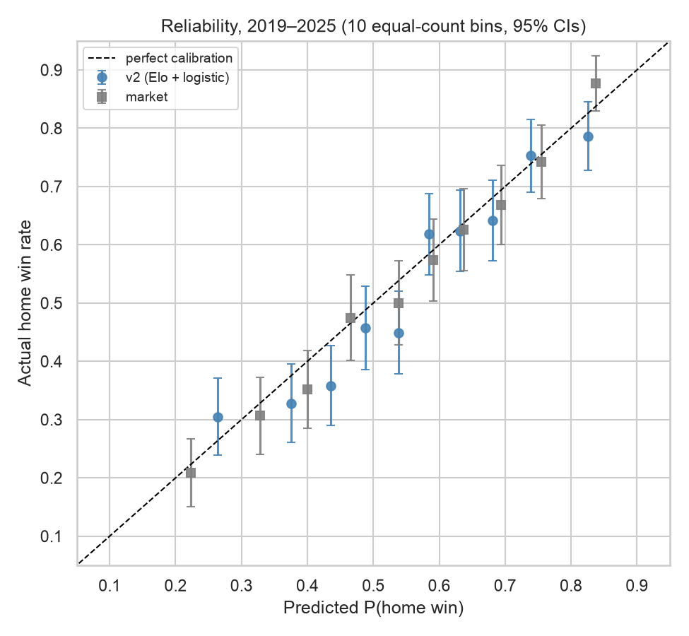
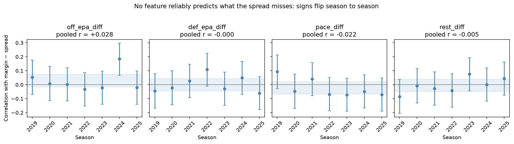

# NFL Win-Probability Model

**A leakage-safe NFL model built end-to-end with pandas and scikit-learn, and tested honestly against the betting market.**

It started as an attempt to beat the point spread. Rigorous testing showed public team stats can't do that, so the project pivoted to a model that *can* be useful: pregame win probabilities. The deliverable is an Elo rating model with a starting-quarterback adjustment, walk-forward validation, pre-registered success criteria, and a live 2026 ledger locked before every kickoff.

> **Live site: [josh-silverman.github.io/nfl-ats-predictor](https://josh-silverman.github.io/nfl-ats-predictor/)** shows this week's picks, the live record, and power rankings.
> **Status (2026-10-22):** model complete; live 2026 record through Week 6, with Week 7 locked (`reports/live_2026.md`, updated weekly).

## Headline results (walk-forward 2019–2025, 1,865 games, 95% bootstrap CIs)

| Model | Picks the winner | Log loss (lower = better) | AUC |
|---|---|---|---|
| Always pick the home team | 53.2% [50.8, 55.4] | 0.693 | — |
| Elo | 63.6% [61.4, 65.8] | 0.639 | 0.692 |
| **Elo + QB availability (the deliverable from 2026 Week 8)** | **64.3% [62.1, 66.4]** | **0.635** | **0.698** |
| Elo + logistic recalibration (v2) | 63.2% [61.0, 65.5] | 0.639 | 0.691 |
| Betting market (moneyline, devigged) | 66.5% [64.3, 68.7] | 0.608 | 0.727 |

- **Useful:** Elo beats knowing nothing by about 10 points (paired log loss −0.054 [−0.070, −0.039]), in every season.
- **QB news helps a little:** taking about 3.6 points off a team whose usual starting QB is out beat plain Elo in 6 of 7 seasons (see section 3).
- **Honest about the gap:** it trails the market by about 2–3 points. The market knows things final scores don't, like injuries and late news.
- **A known weakness, reported rather than hidden:** both models over-predict home wins by about 2–3 points (up to 6–7 points in 2019–2020, when home-field advantage shrank), so neither passed the pre-registered calibration criterion.



## The story

### 1. The original question: can public stats beat the spread? (No.)
I built a full against-the-spread (ATS) model:
- **Features:** play-by-play EPA, pace and rest, lagged with `shift(1)`, with early-season shrinkage toward the prior season (fit inside each fold).
- **Model:** a scikit-learn `Pipeline`, walk-forward validated.
- **Result:** **51.3% [48.9, 53.5]**, short of the 52.4% needed to profit at −110, with log loss *worse* than a coin flip.

A structured diagnosis ruled out every other explanation (`notebooks/08-diagnostics.ipynb`):

| Check | Finding |
|---|---|
| Bugs? | A deliberate leak jumps accuracy to 57% (a fake edge). The honest pipeline shows nothing like it, and unit tests prove the as-of rules. |
| Could we even see a gain? | With about 1,800 games, the minimum detectable gain is 1–2.4 accuracy points. Proving profit needs a true rate of about 55.7%. |
| Do the features know anything the spread doesn't? | Correlation with the spread's miss (margin − spread) is about 0 for every feature, and the sign flips by season. |
| Model or tuning problem? | Learning curves and a regularization sweep both converge on "always 50%". It's a no-signal problem. |
| Do any features earn their place? | 0 of 4, under a pre-set keep rule. |

**Conclusion:** the closing spread already prices in what season-to-date public stats know. Any remaining linear signal is at most breakeven-sized.



### 2. The pivot: who wins?
The same information predicts *winners* well. A 30-line Elo model built from final scores alone matched the whole EPA pipeline (63.6% vs. 63.2%). So Elo became the model, judged against criteria **pre-registered before scoring**:
- S1 useful vs. the base rate: ✅ pass
- S2 non-inferior to raw Elo: ✅ pass
- S3 calibrated: ❌ fail, for both models (the home-team bias above)
- S4 a locked live record: in progress
- S5 a professional build: in progress

### 3. Trying to beat Elo, honestly
Four improvements were each pre-registered (committed to git *before* running), run once, and judged against Elo with a fixed keep rule:

| Idea | Log-loss change vs. Elo [95% CI] | Verdict |
|---|---|---|
| Home-field advantage from recent seasons | +0.0004 [−0.0021, +0.0029] | Rejected: it chases year-to-year noise |
| Starting QB ruled out (official injury report, as-of) | −0.0006 [−0.0032, +0.0020] | Rejected. The signal is real (right sign in every season, 72.5% vs. 62.5% on affected games), but too rare (about 4% of games) |
| Play-by-play EPA on top of Elo | −0.0013 [−0.0059, +0.0034] | Rejected: within noise |
| **Usual starting QB out, including injured reserve (weekly rosters), as Elo points** | **−0.0041 [−0.0076, −0.0004]** | **Kept** (6/7 seasons, AUC 0.692 → 0.698). A missing No. 1 QB ≈ 90 Elo ≈ 3.6 points. The deliverable from 2026 Week 8 |

### 4. The live test (2026)
Every week, `scripts/predict_week.py` predicts each upcoming game using only earlier results. It refuses to overwrite a file, skips games that have already kicked off, and refuses to run on stale data. The file is committed to git before Thursday's kickoff, so the timestamps prove the lock. Weeks 1–5 were backfilled after the fact and are reported separately. **Results: [`reports/live_2026.md`](reports/live_2026.md).**

The live report also tracks **whether the betting line moves toward our number** after we lock: a closing-line-value check, the standard test of whether a model knows something the market doesn't. About 50% means no edge. It was pre-registered before any of it was computed.

## How it guards against fooling itself
- **No leakage:** every feature uses only games before kickoff. Perturbation tests wreck a game's data and assert that nothing at or before it changes. Post-game columns, including the schedule's "who actually started at QB", are blocked as features in code.
- **Walk-forward only:** no random splits. Scalers, shrinkage and models are fit inside each training fold.
- **Paired bootstrap CIs** on the same games for every comparison, plus a dispersion guard (AUC), so a model can't "win" just by being less confident.
- **Pre-registration and a full experiment log:** every result, including failures, is in `reports/experiments.md`, with a running count of experiments for multiple-testing honesty.
- **An independent skeptic review** at each milestone. Its corrections are logged (`docs/learning/mistakes.md`).

## Limitations
- **Market benchmark:** the moneylines come from nflverse schedules. They aren't verified as closing lines, and their source changes around 2023.
- **2019–2025 is not a pristine holdout:** it was examined many times during the diagnosis. The 2026 live ledger is the only clean test.
- **Elo:** FiveThirtyEight-style parameters, but regular-season games only, with no QB, travel or rest adjustments. Home field is fixed.
- **ATS features:** EPA comes from nflfastR's model, which was trained partly on the test seasons.

## What I'd do next
1. **QB quality, not just availability:** the QB adjustment is one fixed size. A backup who's nearly as good as the starter costs less than a big drop-off; a per-QB rating (as FiveThirtyEight did) could capture that.
2. **Opening lines and closing-line value:** grading against the opener is where bettors find edges, but it needs a new data source.
3. **More seasons, or a pooled multi-league approach**, to shrink the confidence intervals that made real-but-small effects undetectable.

## Run it
```bash
conda create -n nfl-ats python=3.12 -y && conda activate nfl-ats
python -m pip install -r requirements.txt && python -m pip install -e .
python -m unittest discover tests                    # 84 tests
python scripts/predict_week.py --week 8              # lock this week's predictions (before Thursday kickoff)
python scripts/predict_week.py --week 8 --qb         # Saturday: re-lock weekend games with final QB injury news
python scripts/score_ledger.py                       # update reports/live_2026.md
python scripts/build_site.py                         # rebuild the site's data (then open site/index.html)
python scripts/run_notebook.py notebooks/10-win-model.ipynb   # re-run the scoring notebook, saving outputs
```
Python ≥ 3.10 is required (nflreadpy). Use the dedicated `nfl-ats` env, not a `.venv` from conda base (see `docs/learning/mistakes.md` #1).

## Layout
| Path | Contents |
|---|---|
| `src/nfl_ats/` | Library: `data`, `target`, `features`, `model`, `evaluate`, `feature_eval`, `diagnostics`, `elo`, `win_model`, `qb`, `ledger`, `site` |
| `tests/` | 84 unit tests (stdlib `unittest`), including leakage and as-of tests |
| `notebooks/` | `03-eda`, `07-backtest`, `08-diagnostics`, `10-win-model` |
| `scripts/` | `predict_week.py`, `score_ledger.py`, `build_site.py`, `run_notebook.py` |
| `site/` | The static site ("Josh's NFL Elo"), deployed to GitHub Pages by `.github/workflows/pages.yml` |
| `ledger/` | Locked weekly predictions (`backfill/` is pseudo-live) |
| `reports/` | `experiments.md` (every result), `live_2026.md`, figures |
| `docs/` | Project rules and pre-registered criteria (`project-rules.md`), design, roadmap, ranked next steps, decisions, learning notes |
