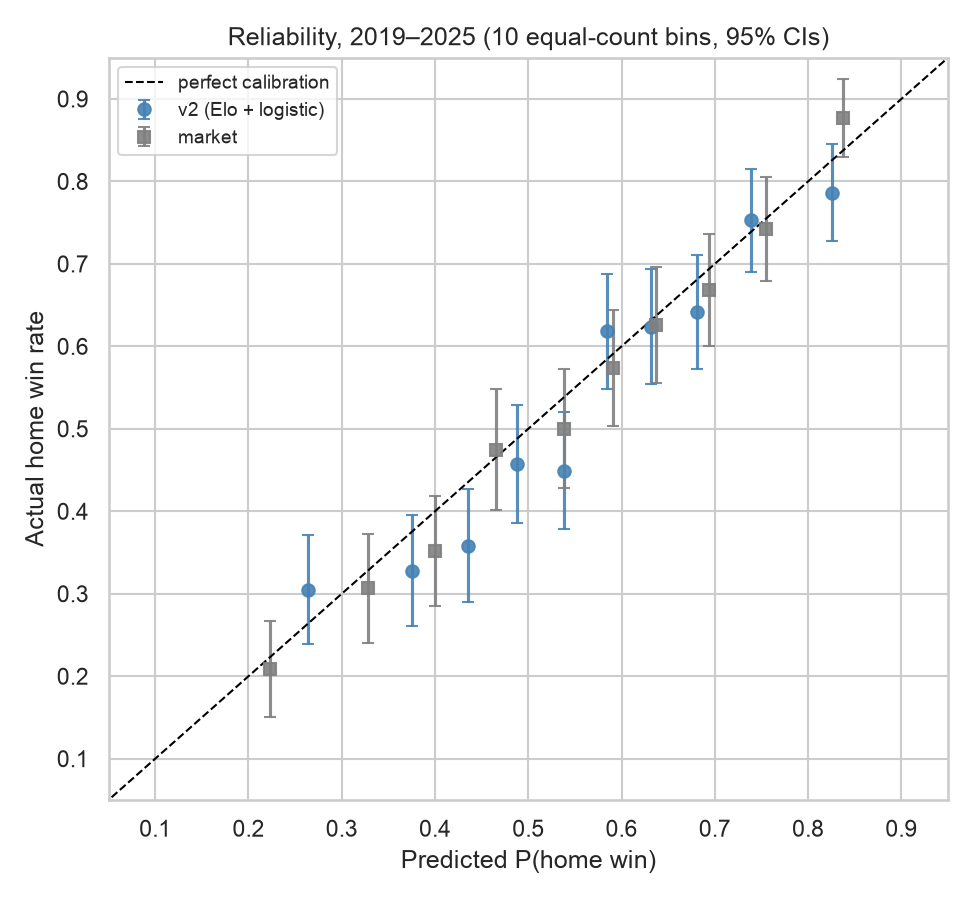
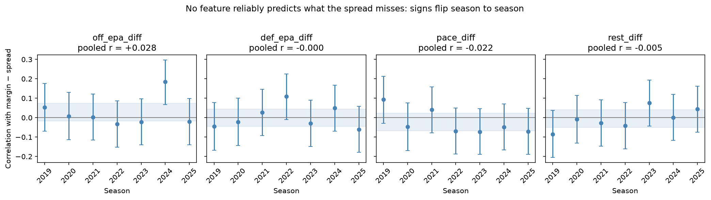

# NFL Win-Probability Model

**A leakage-safe NFL model built end-to-end with pandas and scikit-learn, and tested honestly against the betting market.**

It started as an attempt to beat the point spread. Rigorous testing showed public team stats can't do that, so the project pivoted to a model that *can* be useful: pregame win probabilities. The deliverable is an Elo rating model with a starting-quarterback adjustment, walk-forward validation, pre-registered success criteria, and a live 2026 ledger locked before every kickoff.

> **Live site: [josh-silverman.github.io/nfl-ats-predictor](https://josh-silverman.github.io/nfl-ats-predictor/)** shows this week's picks, the live record, and power rankings with playoff odds (10,000 simulated seasons; at midseason in 2019–2025, teams given 75%+ made it 84% of the time).

<!-- live:start -->
> **Live 2026 (auto-updated Nov 16, 2026):** 70 decided games so far (Weeks 6–9 complete): the headline pick (QB-adjusted Elo from Week 8) picked **67.1%** of winners; the betting market at our lock time picked **72.9%**. Log loss vs. that market: +0.0219 [-0.0238, +0.0664] (positive = the market was better). S4 (≥ 8 locked weeks scored): in progress, 4 of 8. Details: [`reports/live_2026.md`](reports/live_2026.md).
<!-- live:end -->

## Headline results (walk-forward 2019–2025, 1,865 games, 95% bootstrap CIs)

| Model | Picks the winner | Log loss (lower = better) | AUC |
|---|---|---|---|
| Always pick the home team | 53.2% [50.8, 55.4] | 0.693 | — |
| Elo | 63.6% [61.4, 65.8] | 0.639 | 0.692 |
| **Elo + QB availability (the deliverable from 2026 Week 8)** | **64.3% [62.1, 66.4]** | **0.635** | **0.698** |
| Elo + logistic recalibration (v2) | 63.2% [61.0, 65.5] | 0.639 | 0.691 |
| Betting market (moneyline, devigged) | 66.5% [64.3, 68.7] | 0.608 | 0.727 |

- **Useful:** Elo beats knowing nothing by about 10 points (paired log loss −0.054 [−0.070, −0.039]), in every season.
- **QB news helps a little:** taking about 3.6 points off a team whose usual starting QB is out beat plain Elo in 6 of 7 seasons (see section 3).
- **Honest about the gap:** it trails the market by about 2–3 points. The market knows things final scores don't, like injuries and late news.
- **A known weakness, reported rather than hidden:** both models over-predict home wins by about 2–3 points (up to 6–7 points in 2019–2020, when home-field advantage shrank), so neither passed the pre-registered calibration criterion.



## The story

### 1. The original question: can public stats beat the spread? (No.)
I built a full against-the-spread (ATS) model:
- **Features:** play-by-play EPA, pace and rest, lagged with `shift(1)`, with early-season shrinkage toward the prior season (fit inside each fold).
- **Model:** a scikit-learn `Pipeline`, walk-forward validated.
- **Result:** **51.3% [48.9, 53.5]**, short of the 52.4% needed to profit at −110, with log loss *worse* than a coin flip.

A structured diagnosis ruled out every other explanation (`notebooks/08-diagnostics.ipynb`):

| Check | Finding |
|---|---|
| Bugs? | A deliberate leak jumps accuracy to 57% (a fake edge). The honest pipeline shows nothing like it, and unit tests prove the as-of rules. |
| Could we even see a gain? | With about 1,800 games, the minimum detectable gain is 1–2.4 accuracy points. Proving profit needs a true rate of about 55.7%. |
| Do the features know anything the spread doesn't? | Correlation with the spread's miss (margin − spread) is about 0 for every feature, and the sign flips by season. |
| Model or tuning problem? | Learning curves and a regularization sweep both converge on "always 50%". It's a no-signal problem. |
| Do any features earn their place? | 0 of 4, under a pre-set keep rule. |

**Conclusion:** the closing spread already prices in what season-to-date public stats know. Any remaining linear signal is at most breakeven-sized.



### 2. The pivot: who wins?
The same information predicts *winners* well. A 30-line Elo model built from final scores alone matched the whole EPA pipeline (63.6% vs. 63.2%). So Elo became the model, judged against criteria **pre-registered before scoring**:
- S1 useful vs. the base rate: ✅ pass
- S2 non-inferior to raw Elo: ✅ pass
- S3 calibrated: ❌ fail, for both models (the home-team bias above)
- S4 a locked live record: in progress
- S5 a professional build: in progress

### 3. Trying to beat Elo, honestly
Eight improvements were each pre-registered (committed to git *before* running), run once, and judged with a rule fixed in advance. One was kept.

| Idea | Log-loss change vs. Elo [95% CI] | Verdict |
|---|---|---|
| Home-field advantage from recent seasons | +0.0004 [−0.0021, +0.0029] | Rejected: it chases year-to-year noise |
| Starting QB ruled out (official injury report, as-of) | −0.0006 [−0.0032, +0.0020] | Rejected. The signal is real (right sign in every season, 72.5% vs. 62.5% on affected games), but too rare (about 4% of games) |
| Play-by-play EPA on top of Elo | −0.0013 [−0.0059, +0.0034] | Rejected: within noise |
| **Usual starting QB out, including injured reserve (weekly rosters), as Elo points** | **−0.0041 [−0.0076, −0.0004]** | **Kept** (6/7 seasons, AUC 0.692 → 0.698). A missing No. 1 QB ≈ 90 Elo ≈ 3.6 points. The deliverable from 2026 Week 8 |
| Rest / bye-week edge on top of the QB model | +0.0004 [−0.0008, +0.0016] vs. the QB model | Rejected: 3/7 seasons; the rest effect doesn't hold out of sample |
| Home field from the last 10 seasons, tested on **never-viewed 2003–2015** (3,324 games) | +0.0003 [−0.0015, +0.0020] | Rejected: it turned Elo's −1.2-point home bias into +1.1. Season-to-season home bias is about the size of chance (SD ≈ 2.4 vs. ≈ 3.1 points) |
| QB *quality*: size the penalty by the missing QB's recent EPA per dropback | −0.0001 [−0.0004, +0.0002] vs. the QB model | Rejected: the per-fold fit chose a quality weight of 0 in 6 of 7 folds. *Who* is missing matters; how good he was adds nothing Elo doesn't know |
| A fill-in never inherits "usual starter" while the starter is out | −0.0015 [−0.0043, +0.0014] vs. the QB model | Rejected (near-miss: 6/7 seasons, AUC 0.698 → 0.700). Almost all of the effect came from keeping long absences flagged |

After 11 experiments on 2019–2025, those seasons are closed to further testing: their confidence intervals no longer mean what they say. Older seasons helped where the data allowed. A timing audit showed pre-2016 weekly rosters aren't pre-game snapshots (starters listed on the reserve list the week they played), so the QB model can't be retested there, but 2003–2015 works as a fresh test bed for anything built from scores. On those seasons Elo trailed the market by +0.0145 log loss (2010–2015), about half its 2019–2025 gap.

### 4. The live test (2026)
Every week, `scripts/predict_week.py` predicts each upcoming game using only earlier results. It refuses to overwrite a file, skips games that have already kicked off, and refuses to run on stale data. Weeks 1–5 were backfilled after the fact and are reported separately.

Since Week 8 the routine runs itself (`.github/workflows/weekly.yml`):
- **Lock:** each week is locked and committed the day before its first kickoff. GitHub's run log and the commit time prove it; each lock file is also submitted to the Wayback Machine at that commit, a third-party timestamp that outlives GitHub's 90-day logs.
- **QB lock:** each game is re-locked with final QB news once both teams' final injury report and roster are published, so Thursday and holiday games get it too, not just Sunday's.
- **Score and publish:** results are scored after each week and the site rebuilds daily.
- **Watchdog:** every run fails loudly (an email) if any game kicks off within 6 hours without a lock.

**Results: [`reports/live_2026.md`](reports/live_2026.md).**

The live report also tracks **whether the betting line moves toward our number** after we lock: a closing-line-value check, the standard test of whether a model knows something the market doesn't. About 50% means no edge. It was pre-registered before any of it was computed.

## How it guards against fooling itself
- **No leakage:** every feature uses only games before kickoff. Perturbation tests wreck a game's data and assert that nothing at or before it changes. Post-game columns, including the schedule's "who actually started at QB", are blocked as features in code.
- **Walk-forward only:** no random splits. Scalers, shrinkage and models are fit inside each training fold.
- **Paired bootstrap CIs** on the same games for every comparison, plus a dispersion guard (AUC), so a model can't "win" just by being less confident.
- **Pre-registration and a full experiment log:** every result, including failures, is in `reports/experiments.md`, with a running count of experiments for multiple-testing honesty.
- **An independent skeptic review** at each milestone. Its corrections, and my own mistakes, are logged (`docs/learning/mistakes.md`).

## Limitations
- **Market benchmark:** the moneylines come from nflverse schedules. They aren't verified as closing lines, and their source changes around 2023.
- **2019–2025 is not a pristine holdout:** it was examined during the diagnosis and then used for 11 win-model experiments. The 2026 live ledger is the only clean test.
- **Elo:** FiveThirtyEight-style parameters, regular-season games only, no travel or rest adjustments. Home field is fixed at 48 Elo (≈ 1.9 points): about right on average across eras, but the true value moves from season to season by about as much as chance does.
- **QB adjustment:** one fixed penalty (≈ 90 Elo) when a team's usual starter is ruled out, doubtful, or on a reserve list. It doesn't know who the backup is, and other injuries aren't counted.
- **ATS features:** EPA comes from nflfastR's model, which was trained partly on the test seasons.

## What I'd do next
1. **Backup quality, tested on 2026–27 only:** the missing starter's own quality added nothing (above), so the remaining QB question is *who replaces him*. It needs fresh seasons, not another pass over 2019–2025.
2. **Opening lines and closing-line value:** grading against the opener is where bettors find edges, but it needs a new data source.
3. **Score-only ideas on 2003–2015:** Elo mechanics (e.g. letting playoff games update ratings) can still be tested cleanly there.

## Run it
```bash
conda create -n nfl-ats python=3.12 -y && conda activate nfl-ats
python -m pip install -r requirements.txt && python -m pip install -e .
python -m unittest discover tests                    # all unit tests, including leakage and as-of tests
python scripts/auto_week.py --task lock --dry-run   # what the scheduled GitHub run would do right now
python scripts/predict_week.py --week 12             # lock a week by hand (before its first kickoff), then commit
python scripts/predict_week.py --week 12 --qb        # QB re-lock of games whose final injury reports are out
python scripts/score_ledger.py                       # update reports/live_2026.md and the README's live block
python scripts/build_site.py                         # rebuild the site's data AFTER committing the ledger
python scripts/run_notebook.py notebooks/10-win-model.ipynb   # re-run the scoring notebook, saving outputs
```
Python ≥ 3.10 is required (nflreadpy). Use the dedicated `nfl-ats` env, not a `.venv` from conda base (see `docs/learning/mistakes.md` #1).

## Layout
| Path | Contents |
|---|---|
| `src/nfl_ats/` | Library: `data`, `target`, `features`, `model`, `evaluate`, `feature_eval`, `diagnostics`, `elo`, `win_model`, `qb`, `ledger`, `playoffs`, `auto`, `site` |
| `tests/` | Unit tests (stdlib `unittest`), including leakage and as-of tests |
| `notebooks/` | `03-eda`, `07-backtest`, `08-diagnostics`, `10-win-model` |
| `scripts/` | `auto_week.py` (scheduled), `predict_week.py`, `score_ledger.py`, `build_site.py`, `make_og_image.py`, `run_notebook.py` |
| `site/` | The static site ("Josh's NFL Elo"), deployed to GitHub Pages by `.github/workflows/pages.yml` |
| `ledger/` | Locked weekly predictions (`backfill/` is pseudo-live) |
| `reports/` | `experiments.md` (every result), `live_2026.md`, figures |
| `docs/` | Project rules and pre-registered criteria (`project-rules.md`), design, roadmap, ranked next steps, decisions, learning notes |
